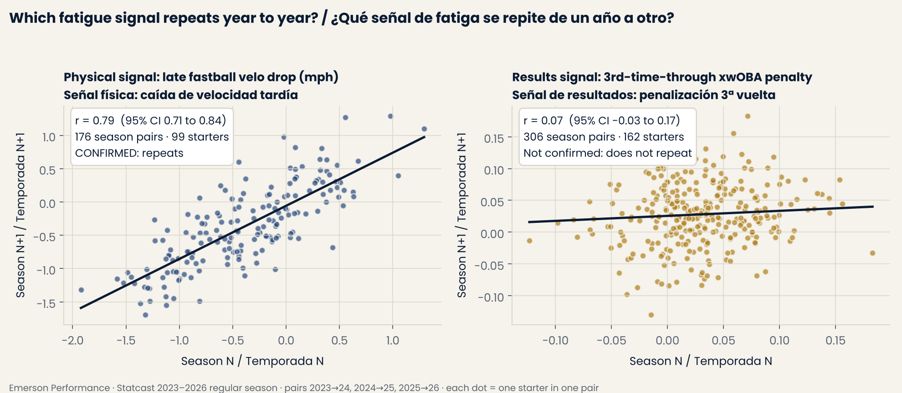
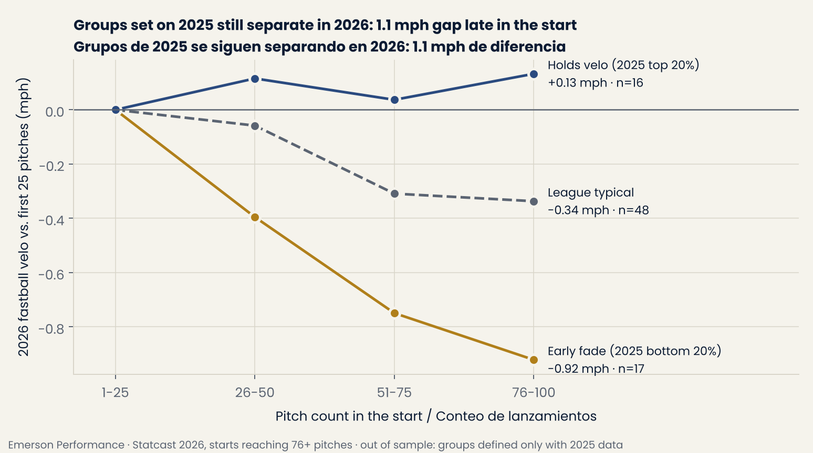

# ep-starter-hook-timing

**Emerson Performance · Starter fatigue and hook timing · Statcast 2023–2026**

[English](#english) · [Español](#español)

---

## English

### Headline

**A starter's in-game velocity fade is a stable personal trait. His third-time-through split is not.**
Across three season pairs (2023→24, 2024→25, 2025→26; 176 pairs, 99 MLB starters), the late-start fastball velo drop repeated year to year (r = 0.79), and each pair alone gave 0.74–0.83. Using each starter's own fade profile cut next-season prediction error by **39%** compared with the league-average rule. The third-time-through-the-order (TTO3) xwOBA penalty did not repeat (r = 0.07, 306 pairs). Using a starter's own TTO3 split made predictions 32% *worse* than the league average.

**Decision rule:**
- **Do not** use pitcher-specific TTO3 splits for hook decisions. Use the league times-through pattern.
- **Do** use each starter's own fade profile to plan: how deep he can go before losing velo, bullpen coverage, and offseason work.
- **In game,** treat fastball velo lost against the first 25 pitches of the same start as a warning signal. Each mph lost came with +0.005 xwOBA: real, but small.

| Test | Result | Label |
|---|---|---|
| H1 · Late velo drop repeats year to year | r = 0.79 (95% CI 0.71–0.84); 176 pairs, 99 starters | `CONFIRMED` |
| H2 · TTO3 xwOBA penalty repeats year to year | r = 0.07 (95% CI −0.03–0.17); 306 pairs, 162 starters | Not confirmed |
| H3a · Own profile predicts next-season velo drop better than league rule | MAE 0.30 vs 0.50 mph (−39%, CI −28% to −48%) | `CONFIRMED` |
| H3b · Own TTO3 split predicts next-season TTO3 split better than league rule | 32% worse (CI 18% to 48% worse) | Not confirmed |
| H3c · Velo fade profile predicts next-season TTO3 split | 0.8% worse than league rule | Not confirmed |
| H4 · Live velo drop comes with worse contact, same pitcher-season | +0.0054 xwOBA per mph lost (CI 0.0030–0.0077); 159,938 PA | `CONFIRMED` (small) |
| H5 · An *unusual* drop for that pitcher costs more than his *usual* drop | Difference −0.0005 xwOBA/mph (CI −0.022 to +0.021) | Inconclusive (underpowered, see below) |

All p-values are Benjamini-Hochberg adjusted across the 9 tests. Bootstrap CIs resample whole pitchers, because a starter can appear in several season pairs.





Groups set **only with 2025 data** (bottom and top 20% of velo fade) still separated by **1.1 mph** late in 2026 starts: early faders −0.92 mph, league-typical −0.34 mph, velo holders +0.13 mph.

### Decision question

Should a club use each starter's own fatigue profile to plan and make hook decisions, or the league-average rule?

### What this means for a front office

1. **Stop using pitcher-specific TTO3 splits.** Their within-season reliability is 0.04–0.21, so they are mostly noise. The league pattern is real (xwOBA ~.302–.310 the first time through and ~.330–.342 the third, 2023–2026), but it is a league effect, not a trait of each pitcher. This fits Brill, Deshpande & Wyner (2023), who found that pitcher performance declines continuously across the game instead of jumping at the third time through.
2. **The velo fade is a trait you can plan around.** Within-season reliability is 0.84–0.92. After about 23 starts that reach 76+ pitches, a starter's shrunk profile reaches ~0.89 reliability. It predicts next season's fade 39% better than the league average.
3. **Live velo is a signal, not a trigger.** Each mph lost (measured before the PA starts, against the same start's first 25 pitches) came with +0.0054 xwOBA in the same pitcher-season. A 2 mph drop is worth about a third of the league TTO3 penalty.
4. **What this does NOT show:**
   - that early faders get hit harder the third time through (H3c);
   - that a drop which is *usual* for a pitcher is harmless while an *unusual* one is costly (H5). That rule sounds right, but these data cannot separate the two (see H5).

### H5: why it is inconclusive, not negative

H5 splits each live drop into the part the pitcher **usually** has at that pitch count (his previous-season curve) and the **unusual** remainder, then compares the xwOBA cost per mph of each part. The unusual part had a clear cost (+0.0049, CI 0.0018–0.0080). The usual part's cost could be anything from −0.016 to +0.027, so the comparison is open.

The synthetic power check shows why. Even when the simulated truth is "only the unusual part costs," the test points the right way but cannot reach significance at this sample size. **Comparing live velo with the pitcher's own curve stays as `INTERPRETATION`.** It needs pitch-tracking data at the practice level, or more seasons, to test.

### Comparison line (league rule)

Without individual information, the best guess for any starter is the league average: about a −0.38 mph fade from pitches 1–25 to pitches 76–100, plus the league TTO pattern. Every model is judged against that rule with leave-one-pitcher-out cross-validation (all of a pitcher's pairs are held out together).

### Application: offseason plan for early faders

`INTERPRETATION`, not tested in this repo.

Lab studies link late-game velo loss to changes in the delivery: less shoulder external rotation and less knee flexion at release (Murray et al., 2001), a more upright trunk as fatigue approaches (Escamilla et al., 2007), and selective strength loss in shoulder internal rotation, flexion and adduction after ~99 pitches (Mullaney et al., 2005). For the 43 starters classified as early faders across 2023–2026 (`outputs/starter_fatigue_profiles.csv`):

| Layer | Content |
|---|---|
| Data | Shrunk late velo drop beyond −0.77 mph (bottom 20%) |
| Finding | The fade repeats year to year (`CONFIRMED`) |
| Biomechanics | Loss of power transfer and shoulder rotator fatigue late in outings (`INTERPRETATION`) |
| Training | Repeat-effort capacity: high-intent throwing blocks with short rest building toward 90–100 pitches, shoulder rotator strength-endurance, lower-body power maintained in-season (`INTERPRETATION`) |
| Monitoring | Simulated-game velo decay test (first 15 vs last 15 fastballs) and pre/post force-plate CMJ; in season, track the fade against his own profile |

**Medical check first.** Most of the strongest early faders had arm or shoulder injuries in the study window: Ober, Gilbert, Springs, Bibee, Ryan, Bradish, Irvin and Morton (`data/injury_exclusions.csv`, with sources). A persistent fade can be an injury signal, not a conditioning problem.

### Data and filters

- Statcast pitch-level data, **regular season only** (`game_type == "R"`): 2023 (720,684 pitches), 2024 (711,899), 2025 (712,528) and 2026 (716,792). `python src/pull_data.py`
- Starter = first pitcher of each team in each game. Primary fastball = FF or SI, whichever he throws more (FC if neither reaches 15%).
- **Velo drop per start** = mean fastball velo on pitches 76–100 minus pitches 1–25 *of the same start* (at least 5 fastballs in each window). A pitcher-season qualifies with 8+ such starts.
- **TTO3 penalty** = xwOBA 3rd time through minus 1st time through (at least 40 and 80 PA). xwOBA = Statcast expected wOBA on contact, actual wOBA value on walks, HBP and strikeouts.
- **Injury and absence filter, applied before any analysis:** 2,673 of 19,436 starts excluded. Reasons: opener or bulk pitcher (809), return start after a 14+ day gap (695), start followed by a 14+ day gap (690), season ended 14+ days early (479). Sixteen pitcher-seasons with public injury reports are annotated in `data/injury_exclusions.csv` with sources.
- **H4/H5 live velo** = mean of the last 5 fastballs thrown *before* the PA started, minus the start's first-25 baseline. Models use pitcher-season fixed effects, pitch count, times through, platoon, and SEs clustered by game, on PAs after pitch 50.

### Pre-registered thresholds

`CONFIRMED` requires a BH-adjusted p < 0.05 **and** a practical threshold. Stability tests: r ≥ 0.30 with the bootstrap CI above 0. Decision tests: a 5% or larger MAE reduction with the CI above 0. H4: CI above 0. H5: the unusual-minus-usual difference has a CI above 0.

### Sensitivity

`python src/run_sensitivity.py` writes `outputs/sensitivity.csv`. ✔ = `CONFIRMED`, ✘ = not confirmed.

| Setting | H1 pairs | H1 r | H2 r | H3a gain | H4 xwOBA/mph | H5 diff |
|---|---|---|---|---|---|---|
| Base | 176 | 0.79 ✔ | 0.07 ✘ | 39% ✔ | 0.0054 ✔ | −0.0005 ✘ |
| Min 5 late starts | 256 | 0.74 ✔ | 0.07 ✘ | 34% ✔ | 0.0054 ✔ | −0.0005 ✘ |
| Min 12 late starts | 118 | 0.82 ✔ | 0.07 ✘ | 41% ✔ | 0.0054 ✔ | +0.0007 ✘ |
| Baseline pitches 10–30 | 158 | 0.76 ✔ | 0.07 ✘ | 35% ✔ | 0.0049 ✔ | +0.0009 ✘ |
| Late window 81–105 | 113 | 0.77 ✔ | 0.07 ✘ | 34% ✔ | 0.0054 ✔ | +0.0003 ✘ |
| Min 60 TTO3 PA | 176 | 0.79 ✔ | 0.11 ✘ | 40% ✔ | 0.0054 ✔ | −0.0005 ✘ |
| Also drop starts within 30 days before a gap | 145 | 0.77 ✔ | 0.04 ✘ | 36% ✔ | 0.0054 ✔ | +0.0010 ✘ |
| Drop all annotated injury seasons | 162 | 0.74 ✔ | 0.05 ✘ | 33% ✔ | 0.0054 ✔ | +0.0008 ✘ |

**H1, H3a and H4 are confirmed in all 8 settings; H2 and H5 in none.** Removing the injury seasons lowers the stability only slightly (0.79 → 0.74), so the result is not driven by injured pitchers.

### Limitations

- Survivorship: managers pull tired-looking starters, so the late window only sees starts where the pitcher was allowed to continue. Velo fades and their cost are probably understated.
- H4 is associational. Fixed effects remove stable pitcher-season differences, but not same-day factors such as illness or weather.
- H5 is underpowered by design at this sample size.
- The training plan is not tested here.

### Version history (transparency)

- **v1 (not published):** 2025→2026 only (52 starters). It recommended comparing live velo with each pitcher's own curve without testing it. In that version, H3a was confirmed in only 3 of 8 sensitivity settings.
- **v2 (this version):** added 2023 and 2024 (three season pairs) and added H5 to test the own-curve rule. H5 was inconclusive, so the recommendation was narrowed. The 2025→2026 result alone replicates (r = 0.74; H3a gain 31%).
- Fixed before publication: a first H4 draft measured live velo *including* the pitch that ended the PA, which inflated the effect; and the Spearman-Brown inversion for per-start reliability.

### Reproduce

```bash
pip install -r requirements.txt
python src/pull_data.py          # ~30 min, writes data/statcast_2023..2026.csv.gz
python tests/test_synthetic.py   # known-answer tests in three scenarios (10 PASS)
python src/run_analysis.py       # outputs/results.json and tables
python src/run_sensitivity.py    # outputs/sensitivity.csv
python src/make_figures.py       # figures/
```

The synthetic tests build seasons where (1) the fade repeats and raw velo loss costs xwOBA, (2) nothing repeats, and (3) only the unusual part of the fade costs xwOBA. Each test must come out the way the simulated truth says. Test 3 only requires the right direction, which documents the power limit of H5.

### References

- Brill, R. S., Deshpande, S. K., & Wyner, A. J. (2023). A Bayesian analysis of the time through the order penalty in baseball. *Journal of Quantitative Analysis in Sports, 19*(4), 245–262. https://doi.org/10.1515/jqas-2022-0116
- Escamilla, R. F., Barrentine, S. W., Fleisig, G. S., Zheng, N., Takada, Y., Kingsley, D., & Andrews, J. R. (2007). Pitching biomechanics as a pitcher approaches muscular fatigue during a simulated baseball game. *American Journal of Sports Medicine, 35*(1), 23–33. https://doi.org/10.1177/0363546506293025
- Mullaney, M. J., McHugh, M. P., Donofrio, T. M., & Nicholas, S. J. (2005). Upper and lower extremity muscle fatigue after a baseball pitching performance. *American Journal of Sports Medicine, 33*(1), 108–113. https://doi.org/10.1177/0363546504266071
- Murray, T. A., Cook, T. D., Werner, S. L., Schlegel, T. F., & Hawkins, R. J. (2001). The effects of extended play on professional baseball pitchers. *American Journal of Sports Medicine, 29*(2), 137–142.

---

## Español

### Titular

**La caída de velocidad de un abridor dentro del juego es un rasgo personal estable. Su split de la tercera vuelta al lineup no lo es.**
En tres pares de temporadas (2023→24, 2024→25 y 2025→26; 176 pares y 99 abridores de MLB), la caída de velocidad de la recta al final de la salida se repitió de un año a otro (r = 0.79), y cada par por separado dio entre 0.74 y 0.83. Usar el perfil propio de cada abridor redujo el error de predicción de la temporada siguiente en un **39%** frente a la regla promedio de la liga. La penalización de xwOBA en la tercera vuelta al lineup (TTO3) no se repitió (r = 0.07, 306 pares). Usar el split TTO3 propio de cada pitcher empeoró las predicciones en un 32% frente al promedio de la liga.

**Regla de decisión:**
- **No** usar splits TTO3 por pitcher para decidir cuándo sacar al abridor. Usar el patrón de la liga por vuelta al lineup.
- **Sí** usar el perfil de caída propio de cada abridor para planificar: hasta dónde puede llegar antes de perder velocidad, la cobertura del bullpen y el trabajo de offseason.
- **Dentro del juego,** tratar la velocidad perdida frente a los primeros 25 lanzamientos de la misma salida como una señal de alerta. Cada mph perdida vino con +0.005 de xwOBA: es real, pero pequeño.

| Prueba | Resultado | Etiqueta |
|---|---|---|
| H1 · La caída tardía de velocidad se repite de un año a otro | r = 0.79 (IC 95% 0.71–0.84); 176 pares, 99 abridores | `CONFIRMED` |
| H2 · La penalización TTO3 se repite de un año a otro | r = 0.07 (IC 95% −0.03–0.17); 306 pares, 162 abridores | No confirmado |
| H3a · El perfil propio predice la caída del año siguiente mejor que la regla de la liga | MAE 0.30 vs 0.50 mph (−39%, IC −28% a −48%) | `CONFIRMED` |
| H3b · El split TTO3 propio predice el del año siguiente mejor que la regla de la liga | 32% peor (IC 18% a 48% peor) | No confirmado |
| H3c · El perfil de caída predice el split TTO3 del año siguiente | 0.8% peor que la regla de la liga | No confirmado |
| H4 · La caída de velocidad en vivo vino con peor contacto, en el mismo pitcher-temporada | +0.0054 xwOBA por mph perdida (IC 0.0030–0.0077); 159,938 PA | `CONFIRMED` (pequeño) |
| H5 · Una caída *inusual* para ese pitcher cuesta más que su caída *habitual* | Diferencia −0.0005 xwOBA/mph (IC −0.022 a +0.021) | No concluyente (falta de poder estadístico) |

Todos los p-valores están ajustados por Benjamini-Hochberg en las 9 pruebas. Los intervalos de bootstrap remuestrean pitchers completos, porque un abridor puede aparecer en varios pares de temporadas.

Los grupos definidos **solo con datos de 2025** (20% inferior y superior de caída) siguieron separados por **1.1 mph** al final de las salidas de 2026: los que se apagan −0.92 mph, los típicos −0.34 mph y los que aguantan +0.13 mph.

### Pregunta de decisión

¿Debe un club usar el perfil de fatiga propio de cada abridor para planificar y decidir cuándo sacarlo, o la regla promedio de la liga?

### Qué significa para un front office

1. **Dejar de usar splits TTO3 por pitcher.** Su confiabilidad dentro de una misma temporada es de 0.04 a 0.21, así que son casi todo ruido. El patrón de la liga sí es real (xwOBA de ~.302–.310 en la primera vuelta y de ~.330–.342 en la tercera, 2023–2026), pero es un efecto de liga, no un rasgo de cada pitcher. Esto coincide con Brill, Deshpande y Wyner (2023), que encontraron que el rendimiento del pitcher baja de forma continua durante el juego en lugar de dar un salto en la tercera vuelta.
2. **La caída de velocidad es un rasgo con el que se puede planificar.** Su confiabilidad dentro de una temporada es de 0.84 a 0.92. Tras unas 23 salidas que lleguen a 76+ lanzamientos, el perfil ajustado del abridor alcanza ~0.89 de confiabilidad, y predice la caída del año siguiente un 39% mejor que el promedio de la liga.
3. **La velocidad en vivo es una señal, no un gatillo automático.** Cada mph perdida (medida antes de empezar el turno, frente a los primeros 25 lanzamientos de la misma salida) vino con +0.0054 de xwOBA en el mismo pitcher-temporada. Perder 2 mph equivale a cerca de un tercio de la penalización TTO3 de la liga.
4. **Lo que esto NO muestra:**
   - que los que se apagan temprano reciban más castigo en la tercera vuelta (H3c);
   - que una caída *habitual* para un pitcher no cueste nada mientras que una *inusual* sí (H5). La regla suena lógica, pero estos datos no pueden separar las dos cosas.

### H5: por qué no es concluyente (y no es un resultado negativo)

H5 separa cada caída en vivo en la parte que el pitcher **suele** tener a ese conteo (su curva de la temporada anterior) y el resto **inusual**, y compara el costo en xwOBA por mph de cada parte. La parte inusual tuvo un costo claro (+0.0049, IC 0.0018–0.0080). El costo de la parte habitual puede estar en cualquier punto entre −0.016 y +0.027, así que la comparación queda abierta.

La prueba sintética de poder explica por qué: incluso cuando en la simulación solo cuesta la parte inusual, la prueba apunta en la dirección correcta pero no alcanza significancia con este tamaño de muestra. **Comparar la velocidad en vivo con la curva propia del pitcher queda como `INTERPRETATION`.** Para probarlo hacen falta datos de seguimiento de lanzamientos en las prácticas o más temporadas.

### Aplicación: plan de offseason para los que se apagan temprano

`INTERPRETATION`, no probado en este repo. Para los 43 abridores clasificados como "early fade" en 2023–2026 (caída ajustada mayor de −0.77 mph):

- **Biomecánica:** los estudios de laboratorio asocian la pérdida de velocidad al final del juego con menos rotación externa del hombro y menos flexión de rodilla al soltar (Murray et al., 2001), un tronco más vertical al acercarse la fatiga (Escamilla et al., 2007) y una pérdida selectiva de fuerza en rotación interna, flexión y aducción del hombro tras ~99 lanzamientos (Mullaney et al., 2005).
- **Entrenamiento:** capacidad de esfuerzo repetido, con bloques de lanzamiento de alta intención y descanso corto progresando hacia 90–100 lanzamientos, fuerza-resistencia de los rotadores del hombro y mantenimiento de la potencia del tren inferior durante la temporada.
- **Monitoreo:** test de caída de velocidad en juego simulado (primeras 15 vs últimas 15 rectas) y CMJ en force plates antes y después; en temporada, seguir la caída frente a su perfil propio.

**Primero, revisión médica.** La mayoría de los que más se apagan tuvieron lesiones de brazo u hombro en el periodo estudiado: Ober, Gilbert, Springs, Bibee, Ryan, Bradish, Irvin y Morton (con fuentes en `data/injury_exclusions.csv`). Una caída persistente puede ser una señal de lesión y no un problema de acondicionamiento.

### Datos y filtros

- Datos de Statcast por lanzamiento, **solo temporada regular**, de 2023 a 2026 (unos 2.86 millones de lanzamientos).
- **Filtro de lesiones y ausencias, aplicado antes del análisis:** se excluyeron 2,673 de 19,436 salidas (openers, regresos y salidas pegadas a huecos de 14+ días, y temporadas terminadas antes de tiempo). Dieciséis temporadas con lesiones públicas quedaron anotadas con su fuente.

### Sensibilidad

Ver la tabla completa en la sección en inglés. **H1, H3a y H4 quedan confirmados en las 8 configuraciones; H2 y H5 en ninguna.** Al quitar las temporadas con lesión anotada, la estabilidad baja muy poco (0.79 → 0.74), así que el resultado no depende de los pitchers lesionados.

### Historial de versiones (transparencia)

- **v1 (no publicada):** solo 2025→2026 (52 abridores). Recomendaba comparar la velocidad en vivo con la curva propia de cada pitcher sin haberlo probado, y H3a solo quedaba confirmado en 3 de 8 configuraciones de sensibilidad.
- **v2 (esta versión):** se agregaron 2023 y 2024 (tres pares de temporadas) y la prueba H5 para la regla de la curva propia. H5 no fue concluyente, así que la recomendación se acotó. El par 2025→2026 por separado se replica (r = 0.74; mejora de H3a del 31%).
- Corregido antes de publicar: un primer borrador de H4 incluía el lanzamiento que terminaba el turno dentro de la velocidad en vivo, lo que inflaba el efecto; y la inversión de la fórmula de Spearman-Brown.

---

*Emerson Jimenez · Emerson Performance · [ejimenezperformance.github.io](https://ejimenezperformance.github.io)*
